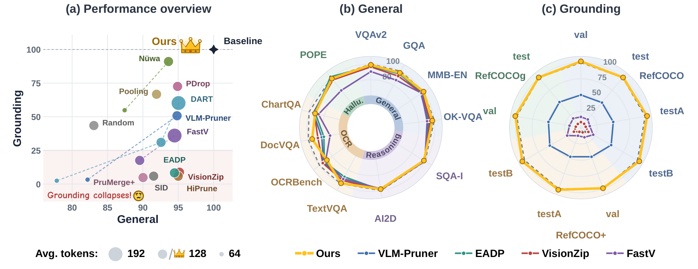
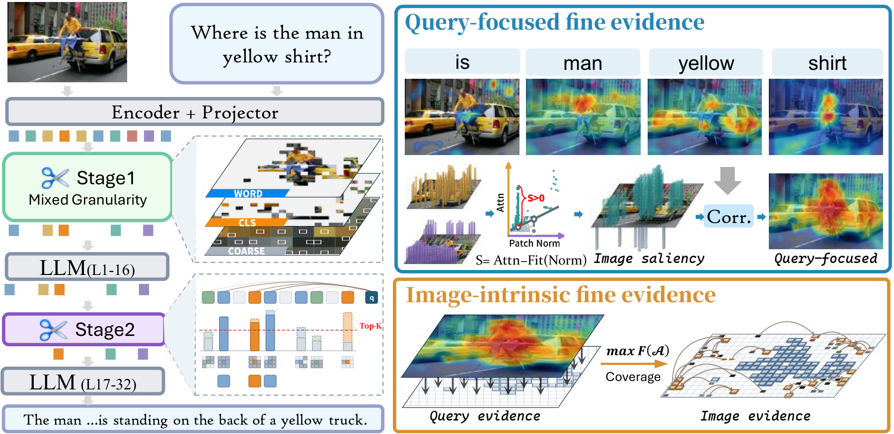

<h1 align="center">
<span>Bifocal: Training-Free Mixed Granularity</span><br>
<span>Visual Token Pruning for Multimodal LLMs</span>
</h1>

<div align="center">

[](https://arxiv.org/abs/2610.18399)
[](LICENSE)
[](https://github.com/EIT-NLP/Bifocal)

</div>

> <strong>Bifocal: Training-Free Mixed Granularity Visual Token Pruning for Multimodal LLMs</strong>
>
> Peiran Yin<sup>1,2</sup>, Hao Wu<sup>1,2</sup>, Zihao Yang<sup>3</sup>, Fengyu Zhou<sup>1</sup>, Yijuan Liang<sup>1,4</sup>, Haozhe Hu<sup>1,2</sup>, Xudong Wang<sup>1</sup>, Wei Zhang<sup>1</sup>, Xiaoyu Shen<sup>†,1</sup>
>
> <sup>1</sup> EIT-NLP Lab, Eastern Institute of Technology, Ningbo · <sup>2</sup> Shanghai Jiao Tong University
>
> <sup>3</sup> Uppsala University · <sup>4</sup> University of Science and Technology of China
>
> <sup>†</sup> Corresponding author.
>
> Contact: [peiran.yin@sjtu.edu.cn](mailto:peiran.yin@sjtu.edu.cn), [xyshen@eitech.edu.cn](mailto:xyshen@eitech.edu.cn)

<p align="center">
  
</p>

<p align="center"><em>Existing pruners stay near the ceiling on general benchmarks but collapse on grounding. Bifocal keeps both, at an average of 128 visual tokens on LLaVA-1.5-7B.</em></p>

## 🔥 News <a id="news"></a>

- **[2026.10]** The code is now released!
- **[2026.10]** The preprint is now available on [arXiv](https://arxiv.org/abs/2610.18399)!

## 📚 Contents <a id="contents"></a>

- [News](#news): Preprint announcements and project updates.
- [Highlights](#highlights): Method overview.
- [Preparation](#preparation): Environment setup and data preparation.
- [Usage](#usage): Evaluation with Bifocal.
- [Results](#results): Main results on three backbones.
- [License](#license): Licensing.
- [Contact](#contact): Questions and collaboration.
- [Related Projects](#projects): Other projects from EIT-NLP.
- [Citation](#citation): How to cite Bifocal.
- [Acknowledgments](#acknowledgments): Upstream implementations.

## 💡 Highlights <a id="highlights"></a>

<p align="center">
  
</p>

- **Diagnosis:** Motivated by the lopsided performance of existing pruners, we examine 20 benchmarks under a small token budget. First, image- and question-driven visual evidence are complementary across tasks, and explicitly allocating the budget between them improves robustness. Second, mean pooling neatly restores both the content and positional integrity broken by pruning.
- **Framework:** We propose a mixed-granularity framework that combines separately budgeted query-focused and image-intrinsic evidence with pooled coarse context, and that also improves existing methods.
- **Method:** We propose Bifocal, which instantiates the framework with dedicated selection rules. Bifocal achieves state-of-the-art averages in all nine model–budget settings and, with roughly a quarter of the visual tokens, retains over 90% of the unpruned performance in every ability group.
- **Results:** In our evaluation, Bifocal is the only method that consistently retains over 90% of the unpruned performance across all five ability groups on all three models with roughly a quarter of the visual tokens. In contrast, every baseline falls below 90% in at least one group, typically grounding or OCR.

## 🔧 Preparation <a id="preparation"></a>

1. **Clone the repository.**

```bash
git clone https://github.com/EIT-NLP/Bifocal.git
cd Bifocal
```

2. **Create the environment and install dependencies.**

```bash
conda create -n bifocal python=3.10 -y
conda activate bifocal
pip install -r requirements.txt

git clone https://github.com/haotian-liu/LLaVA.git
pip install -e LLaVA --no-deps

git clone -b v0.3.4 https://github.com/EvolvingLMMs-Lab/lmms-eval.git
pip install -e lmms-eval

pip install -e .
```

3. **Install the decoder patch.**

```bash
bash install.sh          # symlink patches/modeling_llama.py into transformers
bash install.sh check    # verify the patch is active
bash install.sh restore  # restore the original file
```

4. **Download the model.** Download [llava-v1.5-7b](https://huggingface.co/liuhaotian/llava-v1.5-7b) and set its path:

```bash
export MODEL_PATH=/path/to/llava-v1.5-7b
```

## 🎯 Usage <a id="usage"></a>

### 1. Smoke test

```bash
bash scripts/smoke.sh
```

This checks the patch and runs 8 RefCOCO testA samples with the unpruned model (576) and with Bifocal at 128 tokens.

### 2. Evaluation

```bash
bash scripts/eval.sh <budget> [group] [limit]
```

- `budget`: the average number of visual tokens per LLM layer. The paper uses `192`, `128` and `64`. `576` runs the unpruned LLaVA-1.5 baseline.
- `group`: `general` (default), `grounding`, `all`, or a comma-separated list of lmms-eval task names.
- `limit`: optional number of samples per task for a quick trial.

```bash
bash scripts/eval.sh 128 general
bash scripts/eval.sh 128 grounding
bash scripts/eval.sh 576 all
NPROC=4 bash scripts/eval.sh 64 gqa,pope
```

| Group | Tasks |
| --- | --- |
| `general` | VQAv2 test-dev, GQA, MMBench, OK-VQA, ScienceQA-IMG, AI2D, TextVQA, OCRBench, DocVQA, ChartQA, POPE |
| `grounding` | RefCOCO val/testA/testB, RefCOCO+ val/testA/testB, RefCOCOg val/test |

VQAv2 test-dev requires submission. Convert the lmms-eval output and upload `vqav2_testdev_evalai.json` to the Test-Dev phase of [EvalAI challenge 830](https://eval.ai/web/challenges/challenge-page/830):

```bash
python scripts/vqav2_submit.py results/budget128
```

## ✨ Results <a id="results"></a>

Performance relative to the unpruned model on general (Gen.) and grounding (REC) benchmarks. "Best baseline" is the strongest of ten baselines in each column.

| Model | Budget | Best baseline Gen. | **Bifocal Gen.** | Best baseline REC | **Bifocal REC** |
| --- | --- | ---: | ---: | ---: | ---: |
| LLaVA-1.5-7B | 192 tokens | 98.1% | **98.5%** | 103.6% | **111.0%** |
| LLaVA-1.5-7B | 128 tokens | 95.2% | **96.3%** | 91.1% | **101.8%** |
| LLaVA-1.5-7B | 64 tokens | 90.0% | **90.6%** | 54.9% | **66.7%** |
| LLaVA-NeXT-7B | 640 tokens | 93.7% | **99.1%** | 72.8% | **90.7%** |
| LLaVA-NeXT-7B | 320 tokens | 86.4% | **92.6%** | 36.8% | **74.0%** |
| LLaVA-NeXT-7B | 160 tokens | 78.2% | **79.8%** | 19.0% | **52.1%** |
| Qwen2.5-VL-7B | 50% tokens | 97.6% | **98.4%** | 97.2% | **98.3%** |
| Qwen2.5-VL-7B | 25% tokens | 93.4% | **94.9%** | 85.4% | **90.2%** |
| Qwen2.5-VL-7B | 15% tokens | 86.7% | **89.0%** | 58.0% | **67.9%** |

Budgets are layer-averaged visual tokens on LLaVA models and token fractions on Qwen2.5-VL. See the paper for per-benchmark results.

## 📄 License <a id="license"></a>

Bifocal is licensed under the **Apache License 2.0** (see [LICENSE](LICENSE)). Third-party code retains its original licenses and copyright notices.

## ✉️ Contact <a id="contact"></a>

For questions, suggestions, or collaboration opportunities, please feel free to reach out:

- **Peiran Yin:** [peiran.yin@sjtu.edu.cn](mailto:peiran.yin@sjtu.edu.cn)
- **Xiaoyu Shen:** [xyshen@eitech.edu.cn](mailto:xyshen@eitech.edu.cn)

## 🌐 Related Projects <a id="projects"></a>

- Survey
  - [Awesome-MLLM-Compression] [From Data to Model: A Survey of the Compression Lifecycle in MLLMs](https://github.com/EIT-NLP/Awesome-MLLM-Compression)
- Vision Encoder
  - [CVPR 2026] [UTPTrack: Towards Simple and Unified Token Pruning for Visual Tracking](https://github.com/EIT-NLP/UTPTrack)
- ImageLLM
  - [EMNLP 2025] [VisiPruner: Decoding Discontinuous Cross-Modal Dynamics for Efficient Multimodal LLMs](https://github.com/EIT-NLP/VisiPruner)
  - [ICLR 2026] [HiDrop: Hierarchical Vision Token Reduction in MLLMs via Late Injection, Concave Pyramid Pruning, and Early Exit](https://github.com/EIT-NLP/HiDrop)
  - [Preprint] [ViCA: Efficient Multimodal LLMs with Vision-Only Cross-Attention](https://github.com/EIT-NLP/ViCA)
  - [Preprint] [MWOP: Modality-aware Width-wise Operation Pruning for Efficient MLLMs](https://github.com/EIT-NLP/MWOP)

## 📝 Citation <a id="citation"></a>

If you find this work useful for your research and applications, please consider citing:

```bibtex
@misc{yin2026bifocal,
      title={Bifocal: Training-Free Mixed Granularity Visual Token Pruning for Multimodal LLMs},
      author={Peiran Yin and Hao Wu and Zihao Yang and Fengyu Zhou and Yijuan Liang and Haozhe Hu and Xudong Wang and Wei Zhang and Xiaoyu Shen},
      year={2026},
      eprint={2610.18399},
      archivePrefix={arXiv},
      primaryClass={cs.CV},
      url={https://arxiv.org/abs/2610.18399},
}
```

## 🙏 Acknowledgments <a id="acknowledgments"></a>

This implementation builds on [LLaVA](https://github.com/haotian-liu/LLaVA), [LLaVA-NeXT](https://github.com/LLaVA-VL/LLaVA-NeXT), [Qwen2.5-VL](https://github.com/QwenLM/Qwen2.5-VL), [lmms-eval](https://github.com/EvolvingLMMs-Lab/lmms-eval) and [Transformers](https://github.com/huggingface/transformers). We thank their authors and maintainers.
